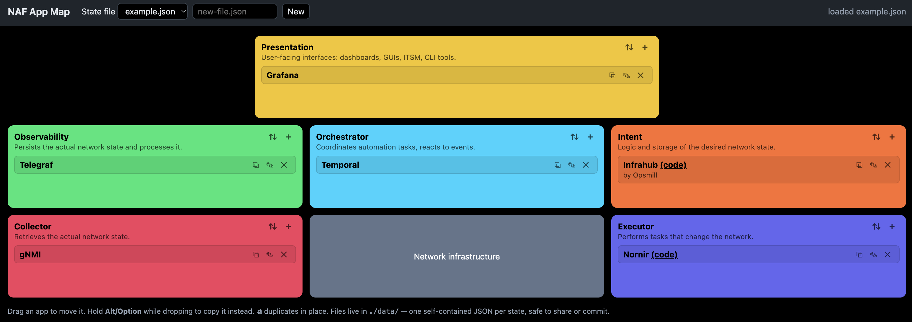

# NAF App Map

A small, locally running web app to map the tools and applications in your network automation stack onto the building blocks of the [Network Automation Forum (NAF) framework](https://reference.networkautomation.forum/Framework/Framework/#architecture).



## Why

When you discuss an automation architecture, the same questions keep coming back: *what do we use for intent? who collects state? is anything orchestrating this?* The NAF framework gives a shared vocabulary for that. This project makes it visual and editable:

- Put each app in the block(s) it fulfils, so you can see gaps and overlaps at a glance.
- Keep one map per team, customer or "current vs. target" state.
- Store each map as a single JSON file that you can share, diff and check into git.

## Features

- The six NAF building blocks (Presentation, Observability, Orchestrator, Intent, Collector, Executor) on top of the network infrastructure, colored per the [NAF brand guidelines](https://reference.networkautomation.forum/Framework/brand-guidelines/#4-color-palette).
- Add apps with a name, a description, a link and a code link (for example, the git repo, shown as `(code)`).
- Drag an app to move it to another block. Hold **Alt/Option** while you drop to copy it instead. ⧉ duplicates it in place.
- Sort per block: manual, A→Z or Z→A. New files default to A→Z.
- Every change is saved to disk immediately. After a restart, the app opens the last file you used.
- Open any map file on your machine, or create a new one in any folder, with the built-in folder browser (**Open / New…**). Recently used files are one click away in the **Recent** menu. Each map is its own file, so maps never interfere with each other.

## Getting started

Requirements: [uv](https://docs.astral.sh/uv/) and [Task](https://taskfile.dev/). uv fetches Python 3.15 automatically if you don't have it. There are no other dependencies.

```sh
task run       # serves http://localhost:28080, Ctrl+C to stop
```

Without Task: `uv run server.py` (port 8080 by default; set `PORT` to change it).

The server listens on `127.0.0.1` only and rejects requests for any other host name, because it can read and write `.json` files anywhere your user can.

## Data

Each map is a single JSON file, stored wherever you choose:

```json
{
  "blocks": {
    "intent":   [{ "id": "…", "name": "Infrahub", "description": "by Opsmill", "url": "", "code": "https://github.com/opsmill/infrahub" }],
    "executor": [{ "id": "…", "name": "Nornir", "description": "", "url": "", "code": "https://github.com/nornir-automation/nornir" }]
  },
  "sort": { "intent": "asc", "executor": "asc" }
}
```

The app only opens files that have a `blocks` object, so it can't accidentally overwrite an unrelated JSON file. The list of recent files is kept in `~/.config/naf-app-map/config.json`.

To share a map, send the file or commit it to git.

## How it is built

This project is deliberately small:
- `server.py`: a Python standard-library HTTP server that serves the page and reads and writes the JSON files.
- `static/index.html`: a single HTML page in plain JavaScript, with native drag-and-drop and `<dialog>` forms.
- `Taskfile.yml`: runs the service.

## License

[MIT](LICENSE)
